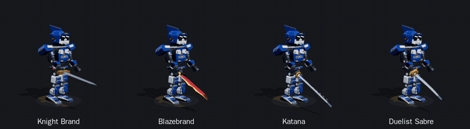
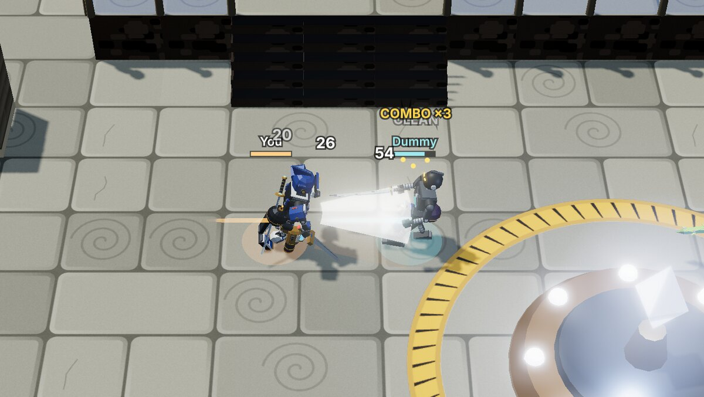
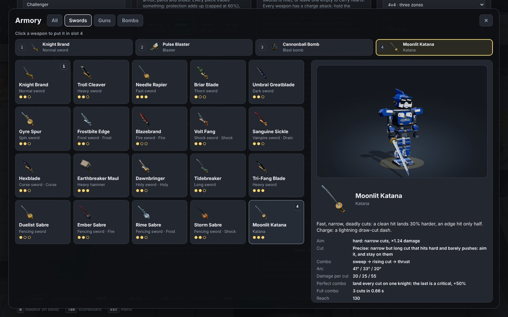
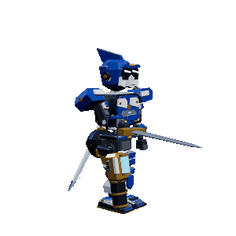
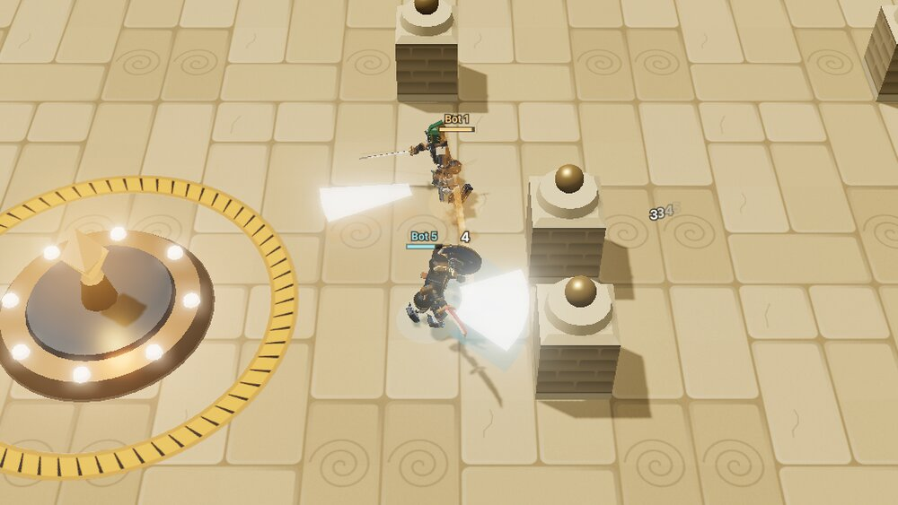
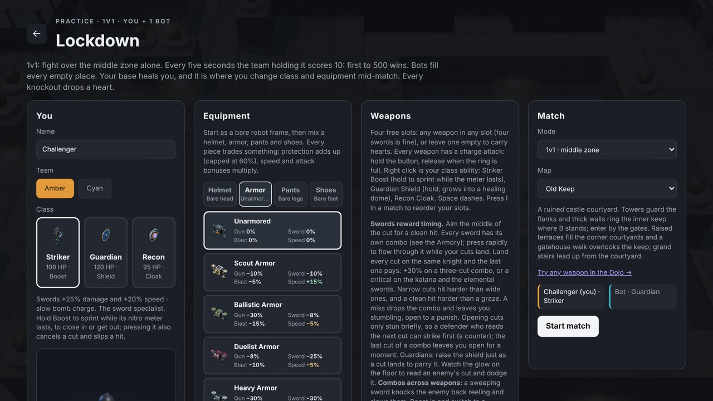

# Lockdown

A control-point brawl in the spirit of Spiral Knights' Lockdown, in the browser: **4v4** over three
capture points, or **2v2** and **1v1** over the middle one. Swords, guns and bombs, Striker / Guardian / Recon
classes, four gear slots, a four-slot inventory with hearts, and bots in every empty place. The knights are
small battle robots (in the style of the LBX anime) built from a frame and swappable armour parts, drawn in
real 3D (three.js): chunky fortresses floating in the void, grand stairs to a second floor, glowing lamps and
crystals.


## What's in it

- **Modes:** 4v4 Lockdown over three zones, or 2v2 and 1v1 fought over the middle zone. Play solo against
  bots, or open an online room for friends; bots fill every empty place.
- **Sword fighting that rewards skill:** every sword type has its own combo (sweeps, rising cuts, overhand
  strikes, a there-and-back flurry, overhead chops, thrusts, spins). Land every cut of a combo on the same
  knight and the last one pays: **COMBO ×3** (+30%), or a **critical** on the katana and the elemental
  swords. A miss drops the combo and leaves you open to a punish, and the opponent can dash out between
  cuts.
- **Aim pays:** narrow cuts hit harder than wide ones, a cut through the middle of a knight is **CLEAN** and
  one that only clips them **GRAZES**. Guns too: a round through the middle hits full, a big round touching
  with its edge grazes, so easy guns hit lighter and precise ones harder.
- **Spiral Knights tricks:** hold attack to show a charge and let go early for a **fake charge** (a normal cut
  that catches a knight who dashed away is a **FEINT**); cancel a landed cut with your class button or the
  dash; sweep a knight back reeling, then boost in with a heavy sword or switch to your gun for a follow-up;
  Guardians parry a cut with a well-timed shield.
- **48 weapons:** 20 swords, 18 guns and 10 bombs, many with elements (fire, ice, shock, poison, curse), each
  with a charge attack. The **Armory** shows how hard each is to aim, its combo, its perfect-combo reward and
  a 3D preview.
- **Your knight carries everything:** swords crossed on the back, pistols in hip holsters, bombs on the belt,
  and switching plays a quick draw. A switch pressed mid-cut is remembered, never lost.
- **Build your knight:** 13 helmets, 15 armours, 11 pants and 11 shoes, each trading something (speed,
  protection, damage, healing...), on top of the class.
- **The Dojo:** a training hall with dummies and a damage meter to try every weapon and charge.
- **Eight arenas,** each with two floors joined by stairs; high ground shoots down, low ground hides.

| | |
|---|---|
|  |  |
| Each sword type moves its own way (half speed) | A perfect combo: every cut lands, the last one pays |
|  |  |
| The Armory: aim rating, combo and perfect-combo reward | Switching draws the weapon from its holster (half speed) |
|  |  |
| 1v1 at the middle zone | Pick 1v1, 2v2 or 4v4 and the arena in the lobby |

## Play

**On Windows:** install [Node.js](https://nodejs.org) 20 or newer once. Download this repository (on GitHub:
**Code → Download ZIP**, then extract it, or `git clone`), and double-click **`start-windows.bat`**. The
first run installs the one dependency, then the game opens in your browser at <http://localhost:3000>.
Close the window to stop it. To get the latest version later, download it again or run `git pull`.

**Anywhere else:**

```
npm install
npm start
```

Then open <http://localhost:3000>. **Play solo** starts a practice match against bots (pick 1v1, 2v2 or 4v4 and
Easy, Normal or Hard bots in the lobby). **Dojo** opens a
training hall with dummies and a damage meter, where **B** changes class, gear and weapons anywhere: the
place to try every weapon and charge attack. **Create room**
opens an online room (1v1, 2v2 or 4v4, Amber vs Cyan); share the link or the six-letter code with
friends on your network, who open the same address. The host picks the mode and the arena and starts the
match.

**French (AZERTY) keyboards:** the game switches to **ZQSD** on its own the first time you play on an AZERTY
keyboard; the **Keys: WASD / ZQSD** buttons at the bottom of the menu switch it by hand.

Controls: **WASD** move, **mouse** aim, **left click** attack (hold to charge, let go early for a fake
charge), **right click** class
ability (Striker Boost, Guardian shield, Recon cloak), **Space** dash, **1–4**, **Q** or the **wheel** (down: next, up: previous, wrapping round) switch slot,
**I** inventory, **B** equipment in base, **Tab** scoreboard, **M** map, **O** full screen (locks the mouse to the game),
**Esc** menu.

Views: the 3D view is the default; `?quality=low` turns off shadows and glow for slower machines,
`?view=2d` plays the original flat view.

## How it plays

See [docs/GAMEPLAY.md](docs/GAMEPLAY.md) and the [weapons audit](docs/WEAPONS-AUDIT.md): classes, gear, weapons and their traits, the fighting rules
(combos and perfect combos, aim, fake charges, interrupts, counters, perfect dodges, clashes, Spiral
Knights-style cancels), statuses, hearts, the modes and the eight arenas.

## Look and art

Start with [docs/ART-GUIDE.md](docs/ART-GUIDE.md): all the art guidance in one place. See also [docs/LOOK.md](docs/LOOK.md) for the design rules, every number behind the look, and how to add
textures (`public/art/3d/<theme>/`, checked by `node tools/art3d-index.mjs`). Every item to model is in
[docs/CATALOG.md](docs/CATALOG.md) and the model contract in [docs/MODELS.md](docs/MODELS.md). Agents start
with [AGENTS.md](AGENTS.md).

## Project layout

| Path | What |
|---|---|
| `server.js` | static files, room API (`/api/rooms`) and WebSocket rooms (`/ws?room=CODE`), 120 Hz simulation |
| `public/index.html` | start page: play solo, create or join a room |
| `public/lockdown.html`, `lockdown-client.js`, `lockdown.css` | the game page, input, HUD, menus |
| `public/lockdown-engine.js` | deterministic simulation: movement, combat, classes, points, bots |
| `public/lockdown-maps.js` | the eight arenas (walls, two floors, stairs) |
| `public/lockdown-weapons.js`, `lockdown-equipment.js` | the armoury and the gear tables |
| `public/lockdown-renderer3d.js` | the 3D view (three.js, vendored in `public/vendor/three/`) |
| `public/lockdown-renderer.js`, `lockdown-assets.js` | the 2D view, minimap, reticle, and the sprite manifest |
| `public/art/` | 3D textures (`3d/`) and 2D sprites and icons (`lockdown/`) |
| `tools/` | art checkers and indexers; `lockdown-art-kit/` for sprite work |
| `test/` | `npm test` |

three.js is MIT-licensed (`public/vendor/three/LICENSE`).
