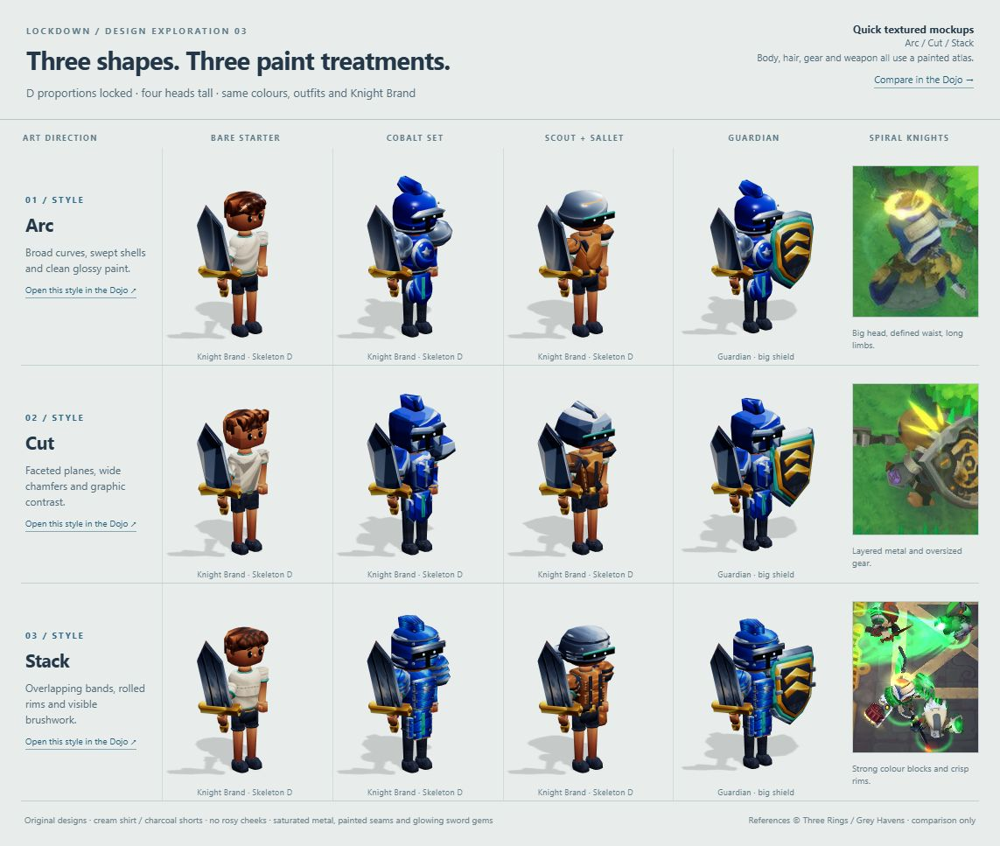

# Lockdown art guide

Everything an artist (or an art agent) needs to make Lockdown's art, in one place. The target is a style
**very close to Spiral Knights**: same proportions, same chunky toy-like shapes, same painted materials, same
bright readable colour, same glow. Everything else is ours: the designs, names and every pixel and vertex are
original. Never copy, trace, rip or recolour Spiral Knights assets, logos or names.

The item list is [CATALOG.md](CATALOG.md): 98 items, each with what it does, how it looks, its size and the
exact files to make. The fine print for models is [MODELS.md](MODELS.md) and for arenas [LOOK.md](LOOK.md);
this guide summarises both, so you can work from this page alone.

---

## 1. The Spiral Knights look

**Look at [reference/spiral-knights/](reference/spiral-knights/README.md) first:** three Spiral Knights
screenshots (a hedge maze, a Lockdown capture point, a base with a bridge) and enlarged close-ups of knights,
with notes on what to take from each. They are reference only: match the style, never copy them.

Spiral Knights is a stylised, cartoon 3D world: chibi knights in clockwork armour exploring a mechanical
planet. Its art works because of a handful of rules. Follow them exactly.

### Shapes
- **Big, simple primary forms with crisp bevels.** Every object reads as two or three clear shapes: a dome
  helmet, a breastplate, a slab blade. Forms are firm and defined, never soft, inflated or bulby. Small detail is rare and always big enough to read at game size.
- **Exaggerated scale.** Helmets are bigger than the head. Swords are as long as the knight is tall. Guns are
  fat, short and toy-like. Shields are big. Heavy items look *ridiculously* heavy.
- **Soft bevels everywhere.** No knife-sharp edges and no perfectly flat boxes. Every edge gets a rounded or
  chamfered bevel that catches the light.
- **Strong silhouettes.** An item must be identifiable from its black silhouette alone at 70 pixels tall. Horns,
  crests, plumes, wings, prongs and flared muzzles are good; thin straps and filigree are not.
- **Segmented, mechanical feel.** Armour is made of separate plates and rings; guns have visible coils,
  cylinders, canisters and vents; there is a clockwork logic to how pieces fit.

### Materials and painting
- **Hand-painted look on simple shading.** Colour comes from painted gradients, not from photographic
  texture. Light tops, darker bottoms, a painted highlight along upper edges, soft ambient occlusion in creases.
- **Metal is painted, not photoreal.** Steel is a cool blue-grey with a bright painted highlight band; gold
  and brass are warm yellow-orange with white-yellow highlights. Shadows lean toward the material's hue, never
  muddy black-grey.
- **Every model gets a hand-painted texture** (one albedo, 512² to 1024²): two to five colour areas per item
  with painted gradients, edge highlights, seams, panel lines and rivets painted in. Wear is a few chips and
  dents, never grime or noise. Flat untextured colours look like a vinyl toy, not Spiral Knights.
- **Glow is an accent.** Energy cores, gems, elemental parts, lenses and runes glow with a bright core and a
  soft halo. The rest of the item never glows.

### Colour
- **Saturated but harmonious.** Clear hues, slightly softened. Each item has one dominant colour, one secondary
  and one small accent (often gold or a glowing element colour).
- **Element colour code** (keep it consistent on every sword, gun, bomb, effect and icon):

| Element | Colours | Feel |
|---|---|---|
| Normal | steel blue-grey, gold trim, a red or blue gem | clean, heroic |
| Fire (burn) | orange-red to yellow, charred black | flickering, hot |
| Frost (chill, freeze) | pale blue, white, cyan glow | crystalline, sharp |
| Shock | cyan and white-yellow, copper coils | crackling, zigzag |
| Poison | acid green, dark teal, purple-black | bubbling, dripping |
| Curse | deep violet, black, magenta runes | smoky, cracked |
| Holy | white, warm gold, soft yellow glow | radiant, feathered |
| Drain | blood red, bone white | sharp, hungry |
| Rift | violet crystal, black frame | floating, angular |

- **Team colours are not part of any item:** Amber `#e39a3b` and Cyan `#3bb8c4` are painted on by the game,
  on materials named `team`.

### Light
- Key light from the **top-left**, a cool fill from the sky, a soft warm bounce from the floor. The game lights
  every model this way, so **never bake lighting or shadows** into textures; paint only form shading
  (light tops, darker undersides, edge highlights).

---

## 2. Knights

### Chosen direction: Stack

**Stack is the approved direction for all new and replacement art.** Use **D**, the four-head skeleton
[`reference/knight_rig_4_heads.glb`](reference/knight_rig_4_heads.glb), at **1.3 units tall**. Keep its named
parts, hierarchy and pivots: a prominent head above a slim, heroic body, defined waist and slender limbs.

Build layered, overlapping plates, banded helmets, rolled rims and firm bevels. Paint broad visible brush
strokes, coloured gradients, dark seams, rivets and sparse edge scuffs. Highlights are **strong and broad
enough to read from the game camera**, concentrated on upper edges and bevels; retain saturated midtones
and deep coloured recesses. Glow stays on small gems and lenses.

Keep each catalogue item's palette: deep cobalt blue and silver for Cobalt, warm tan leather for Scout,
cream shirt, charcoal shorts and shoes, chestnut hair, and warm bronze/gold details. Team colours belong
only on `team*` trims. Follow the **Stack row** below for shape, painting and detail density.

The approved mockups and their source files are saved on the unmerged
[`art/style-mockups` branch](https://github.com/AOSPAndroid/Lockdown/tree/art/style-mockups/review/style-contrast).

Every knight is the same **chibi body** (1.3 units tall) wearing four gear pieces (helmet, armour, pants,
shoes), holding one weapon, with a class mark. Everyone starts with no gear: bare-headed, in a T-shirt and
shorts. That is the game's design and it stays; what matters is that it is **drawn in the Spiral Knights art
style**, exactly like the armour.

- **Proportions: not bulby.** About three heads tall: a big head (about a third of the height, ≈ 0.5 across)
  on a **slim, heroic body**: a narrow torso tapering to a defined waist, slender arms and legs, hands and feet
  in proportion. Only the head (and the helmet on it) is oversized; the body is never round, inflated or
  balloon-like. Armour adds shape where it sits (a breastplate, shin plates, gauntlets) but the knight stays
  lean between the plates. See the knights in [reference/spiral-knights/](reference/spiral-knights/README.md).
- **Face:** simple and stylised, not anime or Animal Crossing: two big glossy dark eyes with a bright
  catch-light, no blush, no mouth or a tiny one. Closed helmets show a **dark visor opening** in which two small
  glowing eyes can show, the classic Spiral Knights look.
- **Base outfit:** a cream T-shirt with a `team` trim, charcoal shorts, chunky dark shoes and a bald scalp. The
  hair is its own piece (the "bare head" helmet): a few big glossy sculpted clumps, never strands.
- **Painted like the armour.** The T-shirt has painted folds, seams and a soft gradient; the hair has painted
  highlights; skin has a warm painted gradient. The bare knight must look like it belongs in the screenshots in
  [reference/spiral-knights/](reference/spiral-knights/README.md), not in a different game.

### The style problem to fix

The first attempt had the right pieces but the wrong art style. Compare it with the references and avoid
every one of these:

| First attempt | Spiral Knights style |
|---|---|
| Flat, untextured colours with soft vertex shading: a matte vinyl toy | A **hand-painted texture on every model**: gradients, painted edge highlights, panel lines, seams, rivets, a few chips |
| Smooth, simple single forms | **Layered** forms: rims, bands, straps, buckles, plates over plates, each with a chunky bevel that catches the light |
| A generic cute chibi face (rosy cheeks) | A stylised face with big glossy eyes, or a dark visor with glowing eyes |
| Muted beige and brown, low contrast | **Saturated** colour, strong light/dark contrast, glowing accents |
| A round, bulby body: balloon torso, sausage limbs, mitten hands, blob feet | A **slim, heroic body** about three heads tall: tapered torso, defined waist, slender limbs, hands and feet in proportion; only the head is big |
| Small, plain weapons | **Oversized**, ornate weapons with glowing parts |

- **Gear reads from above.** The camera looks down at about 48°, so the top of the helmet, the shoulders and the
  weapon are what people see most. Put the most character there: crests, horns, plumes, shoulder plates.
- **Sets.** Pieces with the same name share motifs, colours and materials and must look great together:
  Cobalt (deep blue steel, silver rivets, star emblem), Wolver (grey wolf pelt, ears, claws), Volcanic Demo
  (soot black, orange glowing grilles, fuses), Seraph (white silk, gold edges, halo, small wings), Vog Cub (shaggy
  orange-black fur with ember tips). Every other piece must also look right with any other piece.
- **Class marks** read on any outfit:
  - **Guardian:** a **big shield** on the left arm (a tall heater shield, about as tall as the body), the class piece `class/guardian.glb`.
  - **Recon:** a **tiny round shield** on the left forearm with a glowing lens, the cloaking device, `class/recon.glb`. The game makes the lens flare when it cloaks.
  - **Striker:** nothing to model. The game draws a thin **neon line** in team colour trailing behind it.

---

## 3. Weapons

Spiral Knights weapons are the stars of every screenshot: oversized, chunky, colourful and glowing.

- **Swords:** blade length close to the knight's height for normal swords (≈ 1.05 from grip to tip, blade ≈ 0.2 wide), longer and
  much wider for heavies (≈ 1.3, blades 0.25 wide), long and slim for the rapier and the Tidebreaker, short and
  hooked for the four-cut swords. Big readable cross-guards, a pommel gem, a fuller or an engraved line on the
  blade. Elemental swords make the element the blade itself (ice, flame, lightning, poison vines, runes).
- **Guns:** short, fat and toy-like, steampunk-meets-sci-fi: a rounded brass or steel body, a big grip, a
  visible energy core or canister in the element colour, and a distinctive muzzle (flared trumpet, ringed
  emitter, skull, fangs, claw, double barrel). Length ≈ 0.5 for pistols, ≈ 0.65 for hand-cannons and the
  scattergun, ≈ 1.0 for the rifle.
- **Bombs:** round, heavy and friendly: an iron or glass sphere with a band, a fuse or cap and the element
  showing (smoke, frost, venom, sparks, runes, a vortex window). Held ≈ 0.28 across; planted ≈ 0.4 tall; the
  Nitro Colossus is barrel-sized.
- **Heavy means heavy.** The Troll Cleaver, Umbral Greatblade, Hexblade, Earthbreaker Maul and Tri-Fang Blade
  must look like they take two hands and a run-up.

---

## 4. Arenas

Arenas are built by the game from the map grid; art replaces their materials (textures). The look: a chunky
toy fortress floating in a dark void, built only from walls and two floors, kept open, with grand stairs,
glass railings on brass posts, ball-topped pillars and glowing lamps. Six themes: castle (worn flagstones,
grey ashlar), maze (bright grass, round hedges), foundry (iron plates, red walls with brass X-braces), ruins
(sandstone), graveyard (slate), skyway (white marble with gold inlay, clouds below). Full palettes and rules
are in [LOOK.md](LOOK.md). Per theme, make four textures:

| File (under `public/art/3d/<theme>/`) | Size | Covers | Notes |
|---|---|---|---|
| `floor.png` | 1024² | 4×4 tiles from above | broad bevelled plates, grout inside the image only, an occasional carved swirl; seamless both ways |
| `wall.png` | 1024² | one tile wide × the whole wall face | lit cap band at the top, the theme pattern in the middle, a dark plinth at the bottom; seamless left-right |
| `wall_top.png` | 512² | 1×1 tile from above | lighter than the face; seamless; no outline |
| `cliff.png` | 512² | 1×1 unit | dark foundation rock or girders; seamless |

Optional `<slot>_normal.png` for any of them. Albedo only: no baked light, no perspective, no dark borders.

---

## 5. Menu icons

Every item also needs a menu icon (the armory and inventory show them): `public/art/lockdown/icon_*.png`,
drawn at **96×96** with a transparent background. The Spiral Knights icon style: the item rendered in 3D
from a three-quarter view, slightly from above, filling the frame, lit from the top-left, with a soft dark
outline so it reads on any background. Make icons from your models so they match exactly. File names are in
each catalogue entry (`icon_weapon_<id>`, `icon_helmet_<id>`, `icon_armor_<id>`, `icon_pants_<id>`,
`icon_shoes_<id>`); the class and ability icons (`icon_class_*`, `icon_ability_*`) are listed in
`public/art/lockdown/ASSETS.md`.

---

## 6. Technical rules (models)

- Binary glTF (`.glb`) under `public/art/3d/models/`: `knight/body.glb`, `class/<class>.glb`,
  `helmet|armor|pants|shoes/<id>.glb`, `weapons/<id>.glb`, `bombs/<id>.glb`.
- **1 unit = 1 floor tile; the knight is 1.3 tall; Y up; the knight faces +X**; origin between the feet.
- **Rigid named parts, no skinning, no animation.** The game swings the parts itself. Build the body on
  `docs/reference/knight_rig.glb`: `hips` > `chest` > `head`, `arm_L` > `hand_L`, `arm_R` > `hand_R`, and
  `hips` > `leg_L` > `foot_L`, `leg_R` > `foot_R`, with the same names and pivots.
- **Gear** files hold one top-level node per body part they cover, named after it: helmets `head`; armour
  `chest` (plus optional `arm_L`, `arm_R`, `hips`); pants `hips`, `leg_L`, `leg_R`; shoes `foot_L`, `foot_R`; class
  pieces `head`, `chest` or `arm_L`. Make them slightly bigger than what they cover, since legs swing ±40°, arms ±35°
  and the weapon arm up to ±80°.
- **Weapons:** origin at the middle of the grip, pointing **+X**. **Planted bombs:** origin on the floor, standing
  up +Y.
- **Materials:** glTF metal/rough. Materials named `team…` take the team colour. Glowing parts get an emissive
  colour. At most one 1024² texture set per model, embedded; flat colours with painted vertex shading are fine.
- **Triangle budgets:** body 4000, armour 3000, helmet 2500, pants 2000, shoes/class piece/weapon 1500, planted
  bomb 1200.

Full details: [MODELS.md](MODELS.md).

---

## 7. Do and don't

**Do:** chunky, rounded, oversized, bevelled, painted, saturated, glowing accents, readable from above,
matching sets, the element colour code, original designs.

**Don't:** copy or trace Spiral Knights (or any game's) assets, logos or names; photoreal or noisy textures;
pixel art or voxels; thin spindly parts; grimdark or gore; text on items; baked lighting; team colours in
textures; anything that pokes through other gear when the knight moves; stretching or smearing art to fix it
(redraw instead).

---

## 8. How to work

0. **Design options (stop for a choice).** Before any full model set, show **three or four different design
   directions** for the knight, each one holding the Knight Brand, every one clearly in
   the Spiral Knights style (see [reference/spiral-knights/](reference/spiral-knights/README.md)) but
   different in the **general art style**: proportions, shape language (how round, how blocky, how many
   bevels), how the metal, cloth, skin and hair are painted (glossy or soft, how strong the edge highlights),
   colour and detail level. Show each direction on the bare starting knight (T-shirt, shorts, hair) **and on
   two armoured outfits** (the Cobalt set, and Scout armour with the Sallet helm),
   so the style of the armours can be judged too, not just one outfit. Present them side by side on
   one sheet, each with a short name and what makes it different, next to a reference close-up, plus each one
   in the Dojo at game distance. Quick block-outs are fine: no need to finish or polish, no icons, nothing
   committed as final. Wait until one direction (or a mix) is picked. Repeat if none is right.
1. **Style lock (stop for approval).** In the chosen direction only, make the knight body (with the T-shirt,
   shorts and shoes), the hair (`helmet/none`), the Guardian's big shield and the Recon's tiny shield, the
   Cobalt set (helm, mail, cuisses), the Knight Brand, the Pulse Blaster and the Cannonball Bomb (in hand and
   planted).
   Before showing anything, compare it side by side with the Spiral Knights screenshots in
   [reference/spiral-knights/](reference/spiral-knights/README.md) and with section 2 (the style problem to fix): hand-painted textures, layered bevelled forms, saturated
   colour, a slim body under a big head, oversized weapons. Run the checks, play the game and show screenshots. Change direction if asked;
   do not polish a rejected direction.
2. **Gear:** all 14 helmets, 16 armours, 12 pants and 12 shoes.
3. **Weapons:** all 15 swords, 15 guns and 10 bombs, plus the 10 planted bombs.
4. **Icons** for every item, made from the models.
5. **Arenas:** the four textures per theme, one theme at a time (foundry first).

After every batch:
- `node tools/art3d-index.mjs`: no errors (it checks folders, ids, rig parts, gear nodes, budgets, textures).
- `node tools/lockdown-art-index.mjs`: no errors for icons.
- `npm test`: everything passes.
- `npm start`, open the **Dojo** (<http://localhost:3000/lockdown.html?solo=1&dojo=1>): press **B** anywhere
  to put the item on, and use the dummies to see it from every side. Take screenshots: idle, running,
  swinging, charging (hold attack), hitting a dummy, next to the gallery. For arenas use a solo match
  (<http://localhost:3000/lockdown.html?solo=1>): in base, on a capture point, mid-fight. Put mismatched combinations side by side. Show the screenshots.

Never change gameplay code to make art fit. If an item's description in the catalogue seems wrong, say so.

---

## 9. Delivery checklist

| What | Count | Where |
|---|---|---|
| Knight body | 1 | `models/knight/body.glb` |
| Class pieces | 2 | `models/class/guardian.glb` (big shield), `models/class/recon.glb` (tiny cloaking shield) |
| Helmets (incl. the hair, `none`) | 14 | `models/helmet/<id>.glb` |
| Armour | 15 | `models/armor/<id>.glb` (not `none`: the T-shirt is part of the body) |
| Pants | 11 | `models/pants/<id>.glb` (not `none`) |
| Shoes | 11 | `models/shoes/<id>.glb` (not `none`) |
| Swords | 15 | `models/weapons/<id>.glb` |
| Guns | 15 | `models/weapons/<id>.glb` |
| Bombs | 10 + 10 | `models/weapons/<id>.glb` and `models/bombs/<id>.glb` |
| Icons | 98 | `public/art/lockdown/icon_*.png` (96×96): 40 weapons, 13 helmets, 16 armours, 11 pants, 11 shoes, 3 classes, 4 class abilities |
| Arena textures | 6 × 4 | `public/art/3d/<theme>/{floor,wall,wall_top,cliff}.png` |

Ids, names, looks and sizes for every row: [CATALOG.md](CATALOG.md).
