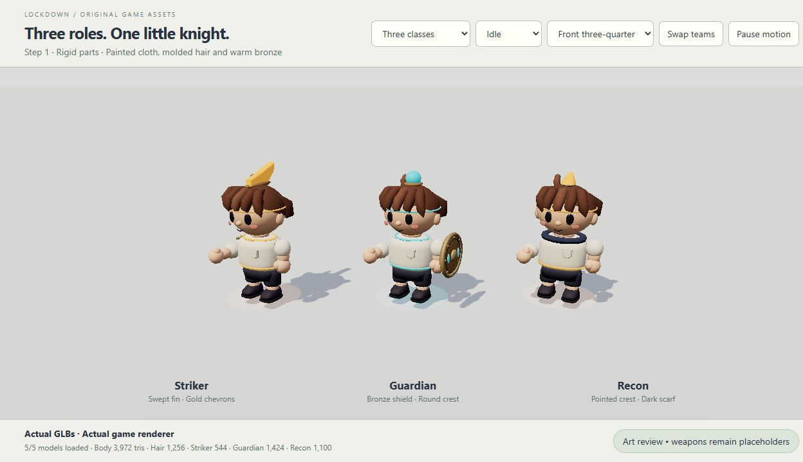
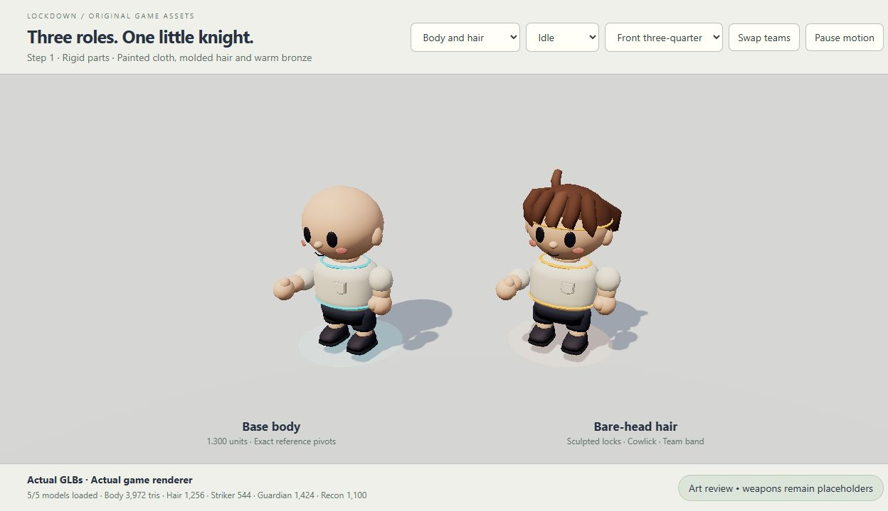
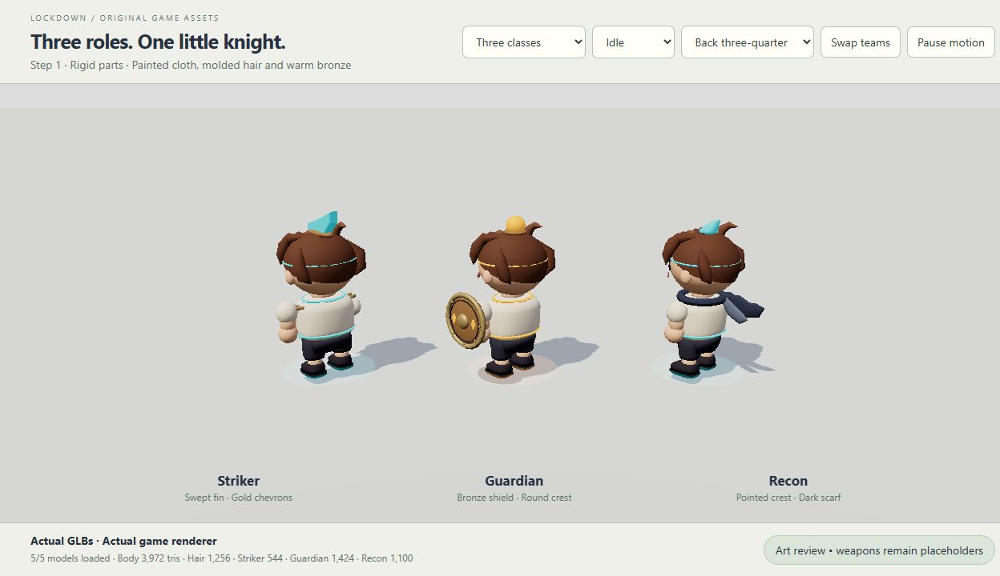
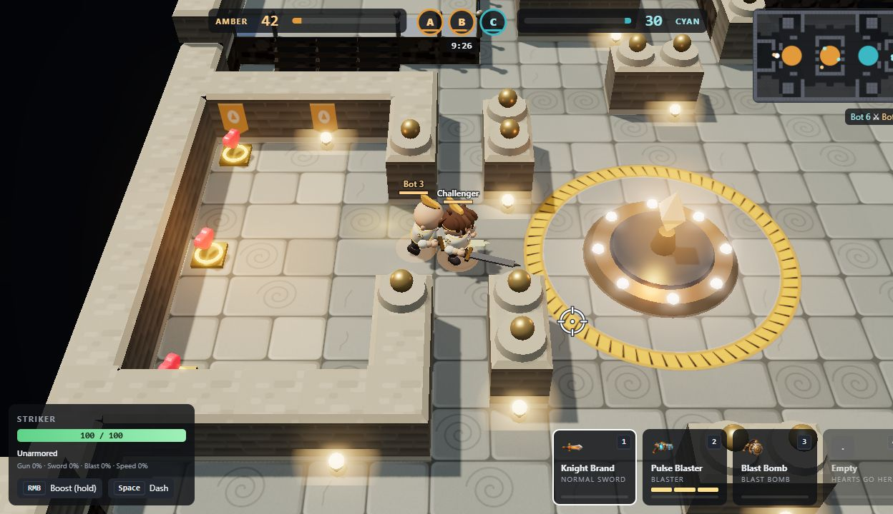
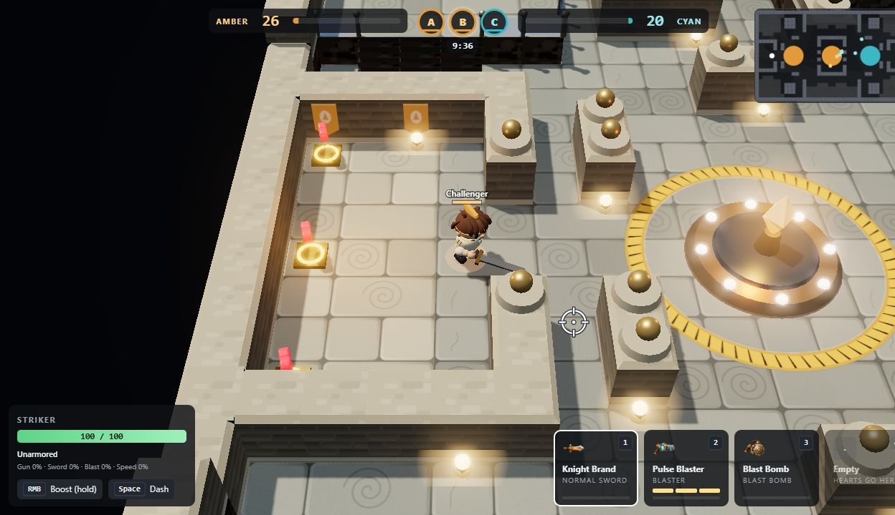
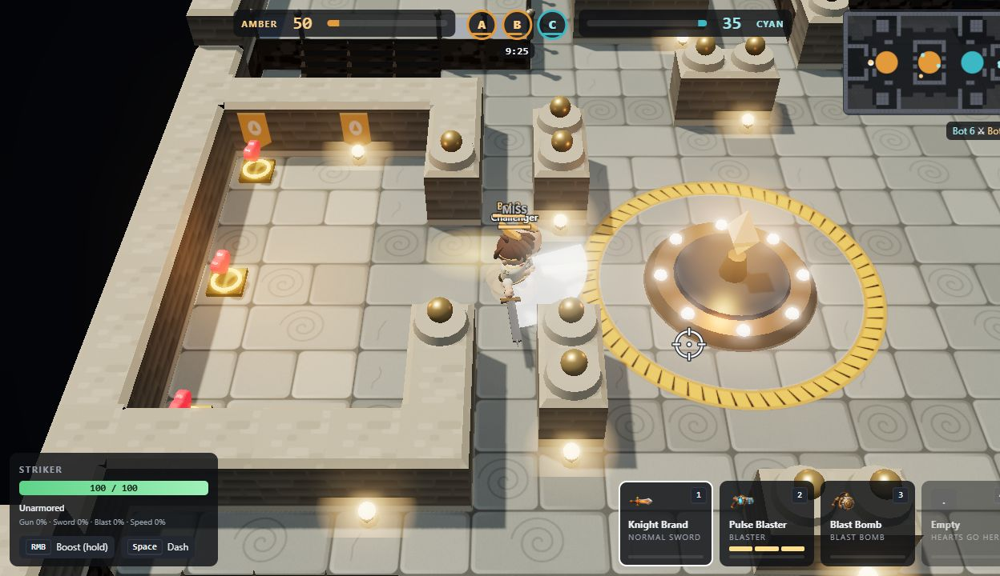
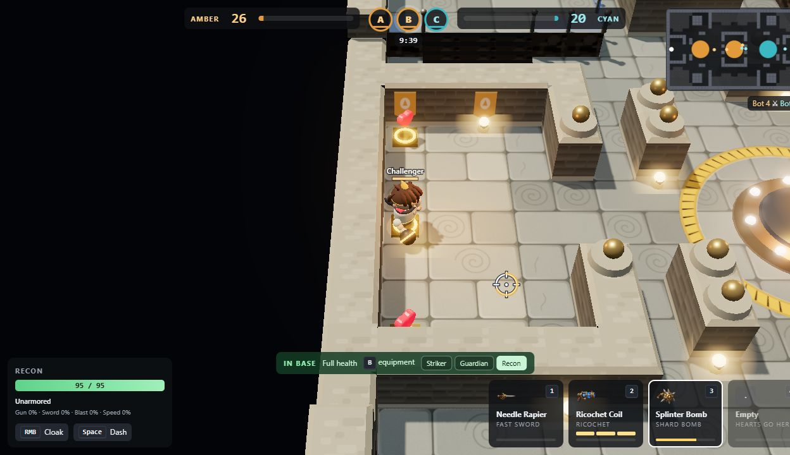
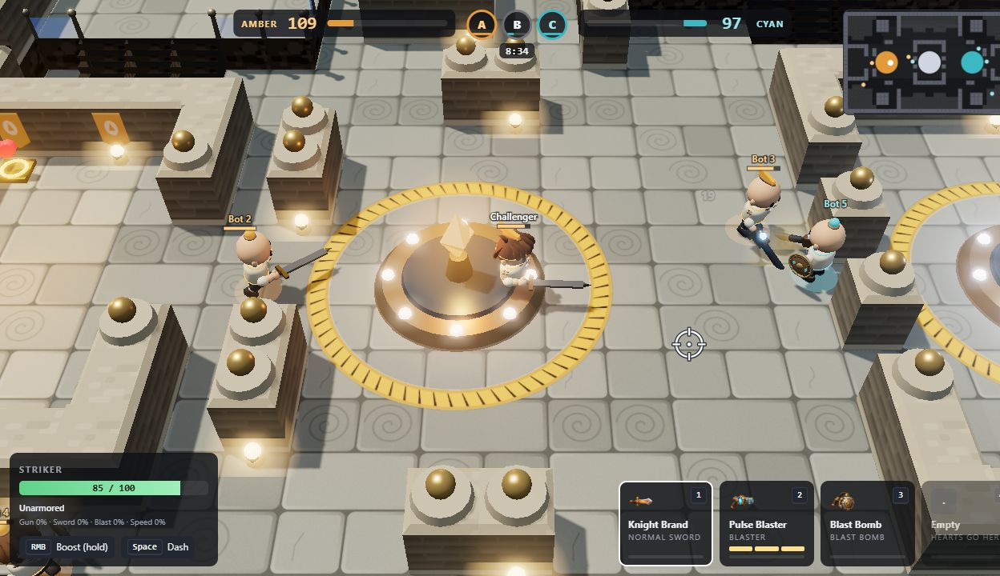
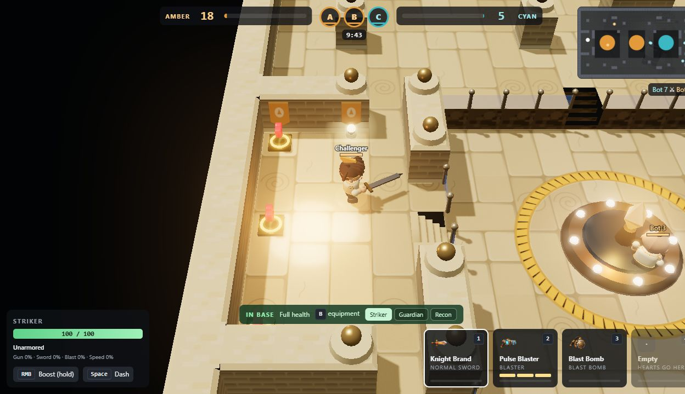

# Step 1: knight foundation — awaiting art approval

Five original GLBs implement the first approval batch. The body, hair and three class pieces are
complete; equipment and weapons in subsequent batches have not been authored. No game or renderer
source was changed.







## Assets

| File under `public/art/3d/models/` | Triangles | Limit |
|---|---:|---:|
| `knight/body.glb` | 3,972 | 4,000 |
| `helmet/none.glb` | 1,256 | 2,500 |
| `class/striker.glb` | 544 | 1,500 |
| `class/guardian.glb` | 1,424 | 1,500 |
| `class/recon.glb` | 1,100 | 1,500 |

The body uses the reference file's exact eleven joint names, parent relationships and local pivots.
Its feet sit at Y=0 and its scalp reaches Y=1.300. It faces +X. Gear roots have zero translation and
are authored in each attachment part's local space. All team accents use the material `team`.
There are no textures, skins, animation clips or authored emissive surfaces. The game's existing
team tint, lighting, charge glow and animation apply to these assets.

## Live game checks

These are unaltered screenshots from `lockdown.html?solo=1`, taken with normal game input. The studio
images above use the same GLBs, material loader and rigid-part animation methods in an isolated
art workbench. Their plain floor and close camera are for inspection.

| Idle near the base entrance | Running out of base |
|---|---|
|  |  |
| Sword swing | Bomb charging |
|  |  |





The game was played in Clockwork Foundry, Old Keep and Sunken Atrium. B opened equipment in base;
all three classes were selected. A random mixed loadout was selected and cleared, and the supplied
class pieces were checked with bare-head hair. The studio additionally checks both teams, rear and
side views, running, swinging and charging.

### Existing issues found, left unchanged

- The renderer only creates temporary gear when the body itself is temporary. Once `body.glb` loads,
  gear that lacks a GLB is absent. The current `MODELS.md` wording promises a temporary fallback for
  every missing file. This limits visual combination checks until later batches are delivered;
  the random loadout menu still selects items and applies their stats.
- `CATALOG.md` gives the Field Medic Coat 3 HP/s in its description and 2 HP/s in its generated stat
  text. The game menu shows 3 HP/s. No description or mechanic was changed.
- Existing tools use URL `.pathname` as a native filesystem path, which produces `C:\C:\...` on
  Windows. The checker and full test suite were therefore run unchanged in Ubuntu WSL. The Windows
  checker also works with its existing explicit directory argument.

## Validation

- `node tools/art3d-index.mjs`: 0 errors, five models indexed (Ubuntu WSL).
- `npm test`: 74 passed, 0 failed (Ubuntu WSL). The first WSL run normalized the generated catalogue's
  CRLF line endings; the subsequent clean run passed. The catalogue's original checkout was restored.
- `node tools/art-models/check-step1.mjs`: exact rig, height, gear roots and budgets passed.
- Khronos glTF Validator: all five files have 0 errors and 0 warnings.

## Rebuild and inspect

```sh
node tools/art-models/build-step1.mjs
node tools/art-models/check-step1.mjs
node tools/art3d-index.mjs public/art/3d
npm start
```

Open `http://localhost:3000/lockdown.html?solo=1` for the game. For the separate inspection page:

```sh
node tools/art-models/serve-preview.mjs
```

Open `http://localhost:3011` to choose body/hair or class views, swap teams and inspect poses.
The workbench is local-only and does not alter the game server.
