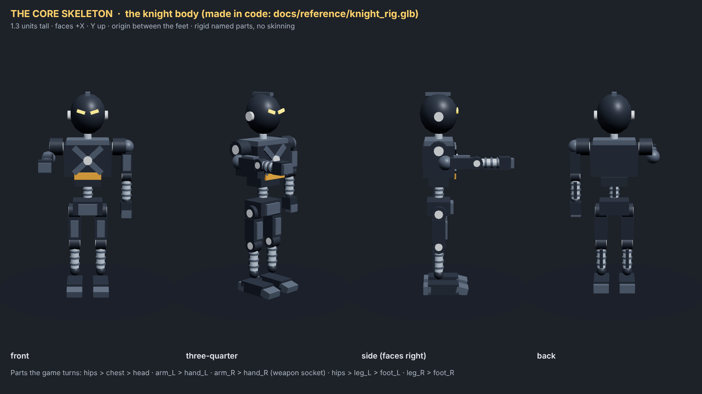
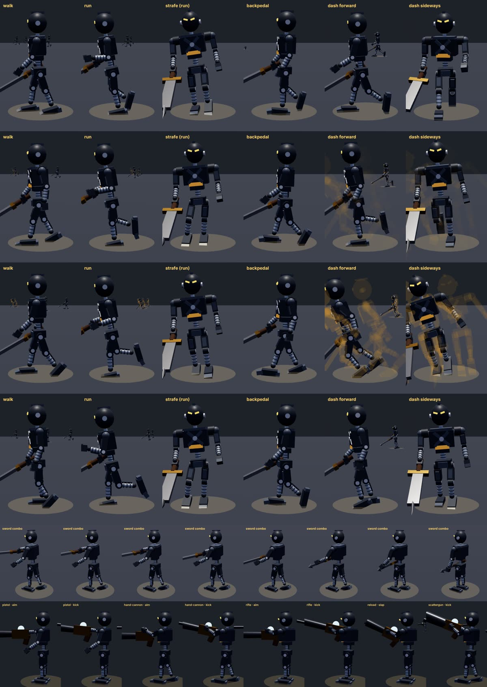
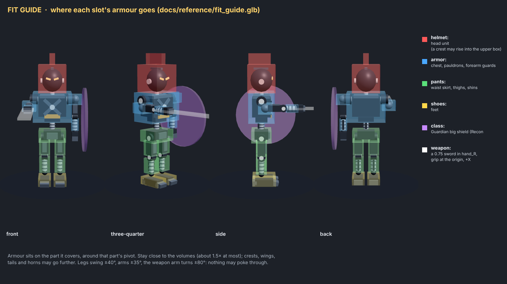
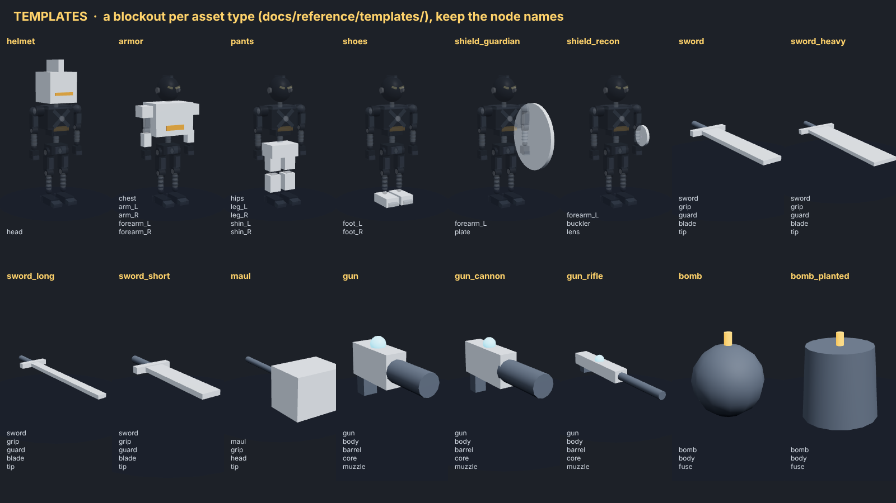
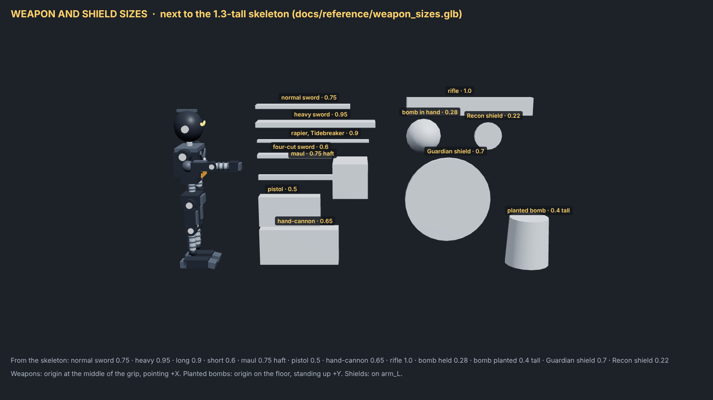

# Asset brief: what to make for Lockdown

**The code is done.** This page is everything an artist (or art agent) needs: what to make, how to build it
on the skeleton, the sizes, and the order. The prompt for the art agent is [CODEX-PROMPT.md](CODEX-PROMPT.md). Details live in [ART-GUIDE.md](ART-GUIDE.md) (style),
[MODELS.md](MODELS.md) (file contract) and [CATALOG.md](CATALOG.md) (every item, with its look and size).

## The look

The knights are **small battle robots in the style of the LBX anime and its model kits**: original designs,
never a copy of an existing LBX robot. Look at [reference/lbx/](reference/lbx/README.md) first.
- Hard-surface armour plates with crisp chamfers, panel lines and gold bolts, a clean painted model-kit finish.
- White or light base plates, one strong main colour per set, one accent, gold details. Glowing eyes and lenses.
- Every armour set has its **own silhouette**: heavy and blocky, sleek, beast, winged (as varied as the LBX line-up).

## The skeleton is made: build on it

The body every knight shares is the **core skeleton**, made in code (`node tools/make-core-skeleton.mjs`
writes `public/art/3d/models/knight/body.glb`). **Don't make a body.** It is also the bare look: a knight with
no gear is just the skeleton.

- [reference/knight_rig.glb](reference/knight_rig.glb): the skeleton. Import it into Blender and model on it.
- 1.3 units tall, faces **+X**, **Y up**, origin between the feet. **Both arms hang down** in the rest pose.
- Rigid named parts, no skinning, no animation clips. 15 parts, split at every joint:
  `hips` > `chest` > `head`, `arm_L` > `forearm_L` > `hand_L` (and `_R`), `hips` > `leg_L` > `shin_L` > `foot_L`
  (and `_R`). Pivots are in [MODELS.md](MODELS.md).
- **The game animates every joint like a body** (see the motion sheet below): a walk that blends into a run,
  hips swinging further forward than back, the knee folding up behind on each stride, feet landing on the heel and
  pushing off the toe; running arms bent to 90°; side-steps when strafing; a dash that dives, leans or tucks the
  knees; sword swings through shoulder, elbow and wrist; gun stances with recoil; lunges, slams, guarding.
  So **split armour at the joints** (a thigh plate on `leg_L`, the knee guard and shin on `shin_L`, a pauldron on
  `arm_L`, the bracer on `forearm_L`) and keep every piece clear of its neighbours when the joint turns.

## Where armour goes: the fit guide

[reference/fit_guide.glb](reference/fit_guide.glb) is the skeleton with a see-through volume for each slot.
Model each piece **around these volumes** (about 1.5× at most; crests, wings, tails and horns may go further):

| Slot | File | Top-level nodes | Volumes (size w×h×d, centre, in the part's own space) |
|---|---|---|---|
| helmet (head unit) | `helmet/<id>.glb` | `head` | 0.30 × 0.30 × 0.30 at (0, 0.15, 0); crest zone 0.24 × 0.12 × 0.06 at (−0.02, 0.36, 0) |
| armor | `armor/<id>.glb` | `chest`, `arm_L`, `arm_R`, `forearm_L`, `forearm_R` (optional `hips` for coat tails) | chest 0.28 × 0.32 × 0.42 at (0, 0.25, 0); pauldrons 0.15 × 0.11 × 0.15 at (0, 0, 0) on each `arm_`; bracers 0.08 × 0.13 × 0.08 at (0, −0.09, 0) on each `forearm_` |
| pants | `pants/<id>.glb` | `hips`, `leg_L`, `leg_R`, `shin_L`, `shin_R` | waist skirt 0.22 × 0.13 × 0.30 at (0, −0.01, 0); thighs 0.12 × 0.17 × 0.12 at (0, −0.1, 0) on each `leg_`; knees and shins 0.12 × 0.17 × 0.12 at (0, −0.1, 0) on each `shin_` |
| shoes | `shoes/<id>.glb` | `foot_L`, `foot_R` | foot 0.26 × 0.09 × 0.14 at (0.03, −0.055, 0) |
| class | `class/guardian.glb`, `class/recon.glb` | `forearm_L` | Guardian shield ≈ 0.7 across at (0.03, −0.1, −0.08), facing out (−Z); Recon shield ≈ 0.22 across at (0.02, −0.09, −0.055) |

Each top-level node is put on that part of the skeleton as it is: **its origin is the joint at the top of the part**
(the shoulder for `arm_L`, the elbow for `forearm_L`, the hip for `leg_L`, the knee for `shin_L`), and the piece
is modelled in that part's own space, exactly like the templates. Nothing may poke through at these ranges:

| Joint | Range the game uses |
|---|---|
| hip (`leg_`) | 35° back to 60° forward, 20° out to the side |
| knee (`shin_`) | straight to 110° bent |
| ankle (`foot_`) | 40° up and down |
| shoulder (`arm_`) | 45° back to straight overhead (the slam), 30° out |
| elbow (`forearm_`) | straight to 100° bent |
| waist (`chest` on `hips`) | 30° twist each way, 15° lean |

## Templates: start every piece from one

`docs/reference/templates/` has a blockout for every asset type with the **node names to keep**: `helmet`,
`armor`, `pants`, `shoes` (the fit volumes on the right parts), `shield_guardian`, `shield_recon`, `sword`,
`sword_heavy`, `sword_long`, `sword_short`, `maul`, `gun`, `gun_cannon`, `gun_rifle`, `bomb` and
`bomb_planted`. Open the right one, model over the blocks, keep the names, delete the blocks. The game
animates these named parts:

| Node | In | What the game does |
|---|---|---|
| `barrel`, `muzzle` | guns | the barrel kicks back on every shot; the muzzle flash comes out of `muzzle` |
| `fuse` | bombs (held and planted) | glows and flickers while charging; blinks faster before it blows |
| `tip` | swords, maul | marks the end of the blade |
| `lens` (material name) | Recon shield | flares while the Recon is cloaked |

## Weapons: sizes

[reference/weapon_sizes.glb](reference/weapon_sizes.glb) has every size next to the skeleton. Origin at the
middle of the grip, pointing **+X**. Planted bombs: origin on the floor, standing up +Y.

| Weapon | Length from grip | Notes |
|---|---|---|
| normal sword | 0.75 | blade ≈ 0.12 wide, guard ≈ 0.24 |
| heavy sword | 0.95 | blade ≈ 0.18 wide |
| rapier, Tidebreaker | 0.9 | slim |
| four-cut sword | 0.6 | short, hooked |
| maul | 0.75 haft | head ≈ 0.28 × 0.28 × 0.36 |
| pistol | 0.5 | body ≈ 0.25 tall |
| hand-cannon, scattergun | 0.65 | body ≈ 0.3 tall |
| rifle | 1.0 | |
| bomb in hand | 0.28 across | Nitro Colossus 0.45 |
| planted bomb | 0.4 tall | Nitro Colossus 0.6 |

## Files and limits

- Binary glTF (`.glb`) in `public/art/3d/models/<folder>/<item id>.glb`; ids are in CATALOG.md.
- One hand-painted texture per model, embedded, a power of two (1024² for big armour, 512² for the rest),
  JPEG or WebP for colour. Each `.glb` **under 600 KB**.
- Materials named `team…` take the team colour (a stripe, a band). Glowing parts are emissive; the Recon's lens
  material has `lens` in its name.
- Weapons: the game holds them in the right fist (0.045 below the wrist), origin at the middle of the grip.
- Triangle budgets: armour 3000, helmet 2500, pants 2000, shoes, class piece and weapon 1500, planted bomb 1200.
- `node tools/art3d-index.mjs` checks all of this (ids, nodes, budgets, size, textures, weapon lengths) and must
  report no errors.

## Reusing the step-1 models (refit)

The Stack-style pieces on branch `art/step1-knights` are kept: same designs, same textures, refitted to this
skeleton. Run the checker on them and it lists what to change. What changed since they were made:

| File | Refit |
|---|---|
| `knight/body.glb`, `helmet/none.glb` | delete: the body and the bare head are the core skeleton |
| `helmet/cobalt.glb`, `helmet/sallet.glb` | the head is smaller (5 heads tall now): scale to the 0.30 head volume (about 0.7×), origin at the neck |
| `armor/cobalt.glb`, `armor/scout.glb` | chest: reshape to the 0.28 × 0.32 × 0.42 volume (broader shoulders, less deep). Arms: each arm was one piece down to the wrist and the right arm reached forward. Turn `arm_R` to hang straight down like `arm_L`, then cut both at the elbow, 0.19 below the shoulder: the pauldron and upper arm stay on `arm_L`/`arm_R`, the bracer goes on a new `forearm_L`/`forearm_R` node whose origin is the elbow (move that geometry up 0.19). `hips` coat tails stay |
| `pants/cobalt.glb` | each leg was one piece to the ankle: cut at the knee, 0.215 below the hip; the thigh stays on `leg_L`/`leg_R`, the knee guard and shin go on new `shin_L`/`shin_R` nodes with origin at the knee (move up 0.215) |
| `class/guardian.glb`, `class/recon.glb` | the node becomes `forearm_L` (origin at the elbow); place the shield at the volumes above |
| `weapons/brand.glb` | the length (0.75) is right; split the mesh into child nodes `grip`, `guard`, `blade`, `tip` like `templates/sword.glb` |
| `weapons/blaster.glb` | length right; split into `body`, `barrel` (the part that kicks back), `core`, `muzzle` (where the flash comes out) like `templates/gun.glb` |
| `weapons/blast.glb`, `bombs/blast.glb` | add a `fuse` node (it glows while charging and blinks before the blast) |

Keep the look and push it further toward the LBX references: crisper plate edges, panel lines, glowing eyes.

## Order

1. **Refit (stop for approval):** the step-1 pieces above on the new skeleton, plus `shoes/sabatons` in the Cobalt style. Show them in the
   Dojo: idle, walk, run, dash, sword combo, shooting, Guardian guard.
2. **All armour:** 13 helmets, 15 armours, 11 pants, 11 shoes (not the `none` pieces: that's the skeleton).
3. **All weapons:** 15 swords, 15 guns, 10 bombs + 10 planted.
4. **Icons** (96×96, see ART-GUIDE section 5), made from the models.

After every batch: `node tools/art3d-index.mjs` (no errors), `npm test` (all pass), then `npm start` and open
the Dojo, <http://localhost:3000/lockdown.html?solo=1&dojo=1>: **B** puts gear on anywhere. Show screenshots
(idle, running, swinging, charging) next to the references, and push.
