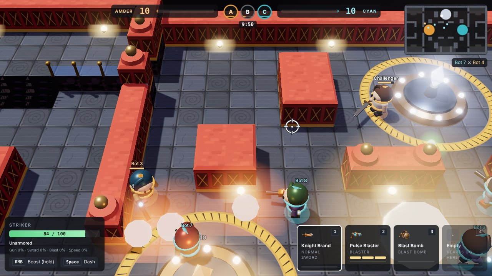
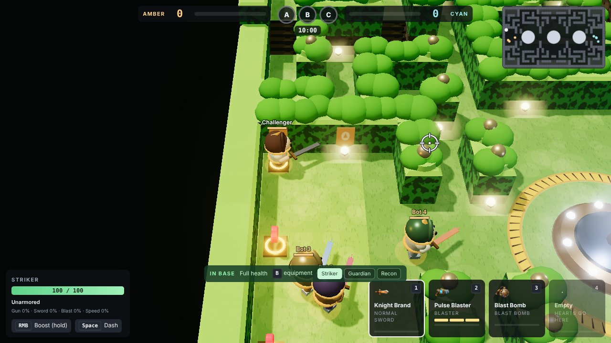
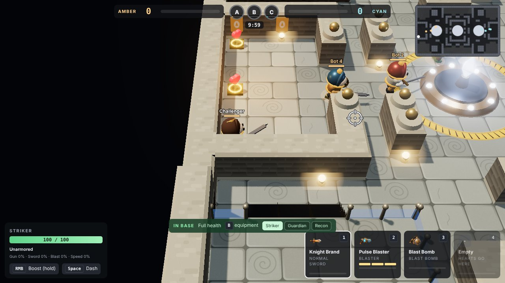
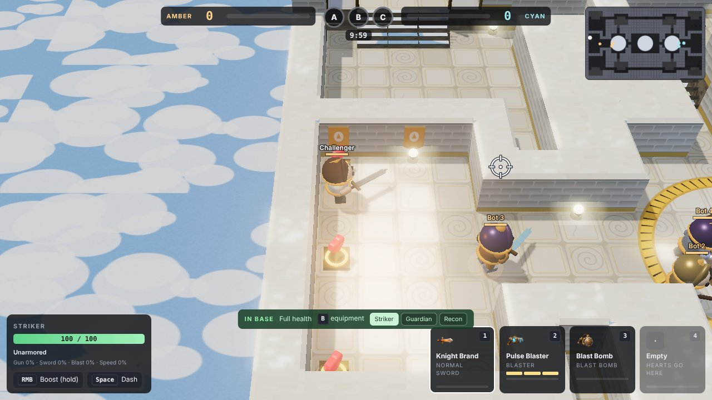

# The Lockdown look

How Lockdown's arenas get their look, and exactly how to make art that keeps it. The knights are LBX-style
battle robots: see [ART-GUIDE.md](ART-GUIDE.md). Read this before touching the arenas. The mechanics are finished; this document is about design and assets.



| Hedge Labyrinth | Old Keep | Sky Bridges |
|---|---|---|
|  |  |  |

## 1. The design, in one paragraph

A steep ¾ perspective camera looks down on a chunky, toy-like fortress floating in a dark void. Arenas
are made only of **walls and two floors**: no pits, no lava, no gaps. The low floor is broad stone or
metal plates; the high floor is a full storey up, reached by **grand stairs**, and its open edges carry
glass barriers on brass posts. Walls are thick bevelled blocks with a lit cap band on top, a patterned
face and a dark plinth at the foot; where a wall line ends, a stout pillar with a brass ball marks it.
Light comes from the top-left, shadows are soft, and everything that glows (lamps, crystals, team
rings, shots, slashes) blooms. Knights are small battle robots (LBX-style, about five heads tall) with a bright team ring
at their feet. Colour does the reading: Amber vs Cyan on rings, helmet bands, banners and capture rings.

## 2. Design rules (do not break these)

1. **Walls and two floors only.** Every arena is built from walls (`#`), low floor and raised floor
   (`levels` in `public/lockdown-maps.js`). No pits of any kind. Height changes only by stairs.
2. **Grand stairs.** A stair climbs exactly one storey and is up to three tiles wide (the map builder
   widens authored stairs automatically). Stairs are real steps with side walls, never ramps or slabs.
3. **Readable from above.** Gameplay reads from a camera ~48° above the floor: silhouettes, team
   colour and the floor's walkable area must be clear at a glance. Detail lives in texture and light,
   never in clutter on the floor.
4. **Chunky and bevelled.** Blocks have chamfered top edges, plates have soft bevels, posts end in balls.
   No thin spindly geometry, no sharp noise.
5. **Light from the top-left, glow for meaning.** Only things that matter glow: lamps, crystals, team
   rings, heart pads, projectiles, slashes, charge and boost. Floors and walls never glow.
6. **Team colour is sacred.** Amber `#e39a3b` and Cyan `#3bb8c4` appear only on team things (rings,
   helmet bands, crests, banners, bases, capture fill). Art never bakes team colour into shared surfaces.
7. **One theme, one palette.** Each arena keeps to its theme palette below.

## 3. The numbers (as built in `public/lockdown-renderer3d.js`)

| Thing | Value |
|---|---|
| Scene unit | 1 map tile = 1 unit (48 world units) |
| Camera | perspective, 34° vertical FOV, offset (0, 12.6, 11.2) from the followed knight: ~48° pitch, ~16.9 units away |
| Raised floor | 0.8 units up (`STOREY`) |
| Walls | 1.3 units above their floor (`WALL`), top edges chamfered 0.1 (`BEVEL`) |
| Cliffs | drop 2.6 units below the floor into the void (`DEPTH`) |
| Knights | 1.3 units tall (battle robots, head ≈ 20% of the height), team ring radius 0.42 |
| Capture court | radius 2.75 units; hazard-striped rim; platform with 8 lamp studs and a floating crystal |
| Lights | hemisphere 1.6 (theme sky over theme ground) + sun 2.4 from the top-left, soft shadows (PCF, 2048 map) |
| Tone | ACES filmic, exposure 1.15 (pale themes lower: ruins 0.9, skyway 0.72) |
| Bloom | strength 0.5, radius 0.5, threshold 0.85 (ruins 0.96, skyway 0.98) |
| Quality switch | `?quality=low` turns shadows and bloom off; `?view=2d` is the old flat view |

### Theme palettes

| Theme (arenas) | Floor | Wall face / dark / top / trim | Cliff | Lamp | Void |
|---|---|---|---|---|---|
| castle (Old Keep, Rampart Walk) | `#8e9088` `#9a9b91` grout `#5f615b` | `#8a7f6e` `#5a5145` `#b9ae97` `#d8cdb4` | `#4a4038` | `#ffcf86` | `#0d1117` |
| maze (Hedge Labyrinth) | grass `#6fa042` `#78aa48` | hedge `#3f8a2c` `#2a5e1e` `#8fd14c` bushes on top | `#5a4a32` | `#fff0a0` | `#0b1410` |
| foundry (Clockwork Foundry) | iron plates `#4e5763` `#556070` | red `#b23e36` `#6e2622` `#d0584a` brass `#e2b04a` | `#3a2e3c` | `#ffe2a6` | `#0b0a12` |
| ruins (Sunken Temple, Sunken Atrium) | sandstone `#cdb88e` `#d6c299` | `#cdb990` `#8e7b58` `#e6d6b0` `#f2e6c6` | `#7a6648` | `#ffe0a0` | `#0c1214` |
| graveyard (Gloom Graveyard) | slate `#4a4e58` `#52566a` | `#5c5a6c` `#38364a` `#7c7a90` `#9a98b0` | `#2c2a38` | `#b8a8ff` | `#0a0a12` |
| skyway (Sky Bridges) | marble `#cfc8b6` `#d8d1c0` gold inlay | `#e8e2d2` `#b0a68e` `#f6f1e4` gold `#d8b45a` | `#9a8c74` | `#fff2c0` | sky `#5f8fcc`, clouds below |

## 4. What is built in code, and what art replaces

Everything renders today from code: geometry from the map grid, and procedural "painted" materials. Art
improves the look by **replacing materials**, slot by slot, with no code changes:

```
public/art/3d/<theme>/floor.png        low and raised floor plates
public/art/3d/<theme>/wall.png         wall faces
public/art/3d/<theme>/wall_top.png     the caps on top of walls
public/art/3d/<theme>/cliff.png        cliffs, stair risers and the fortress's underside
public/art/3d/<theme>/<slot>_normal.png   optional normal map for any slot (OpenGL convention, +Y up)
```

Themes: `castle`, `maze`, `foundry`, `ruins`, `graveyard`, `skyway`. After adding files run
`node tools/art3d-index.mjs`: it checks every texture and writes `public/art/3d/index.json`, which the
game reads. Reload the game and the new material is on.

### Texture rules

| Slot | Size | Covers | Must |
|---|---|---|---|
| `floor` | 1024² (or 512²) | **4×4 tiles**, seen straight from above | tile seamlessly both ways; broad plates (1–2 tiles) with soft bevels, grout lines inside the image, not on its edges; an occasional carved swirl, crack or rivet; quiet enough that knights read on top |
| `wall` | 1024² (or 512²) | **1 tile wide × the full wall face** (top of the image = top of the wall) | tile seamlessly **left-right only**; a lit cap band in the top ~12%, the theme's pattern (blocks, panels with X-braces, hedge leaves…) in the middle, a darker plinth in the bottom ~12% |
| `wall_top` | 512² | 1×1 tile, from above | tile both ways; lighter than the wall face; no outline at the edges (the game bevels the edges itself) |
| `cliff` | 512² | 1×1 unit | tile both ways; dark foundation rock, masonry or girders, darker than everything walkable |

All textures: 8-bit sRGB PNG, fully opaque, square power of two. **Paint albedo only**: no baked
shadows, no baked highlights from a light direction, no perspective, no vignette, no dark border (the
game lights, shadows, bevels and blooms everything). No text, no logos, no team colours.

The tool rejects: wrong sizes, transparency, seams where a texture repeats, darker edges (they draw a
grid over the floor), smeared or stretched rows, unknown slot names.

## 5. How to work (art and design)

1. Pick **one theme**. Make its four textures. Run `node tools/art3d-index.mjs` until it reports no
   errors. Start the game (`npm start`, then <http://localhost:3000/lockdown.html?solo=1>), pick that
   arena, and look at it in play: in base, on a capture point, on the raised floor, mid-fight.
2. Compare with the screenshots above and the rules in section 2. Fix, then repeat.
3. Only when that theme is approved, do the next one.
4. Never edit gameplay code (`lockdown-engine.js`, `lockdown-weapons.js`, `lockdown-equipment.js`,
   bots, server) to make art fit. Map *layout* changes (`lockdown-maps.js`) are design work: keep the
   two-floor rules, keep both halves mirrored, and run `npm test` (bots must still finish matches).
5. Run `npm test` before every commit.

### Menus and icons

The menus (armory, inventory, loadout) use 2D icons from `public/art/lockdown/` (`icon_*`, `weapon_*`,
`ui_*`). Those follow `public/art/lockdown/ASSETS.md` and `tools/lockdown-art-kit/` (with its own
checker). Restyle them to match the 3D look: chunky, rounded, painted, lit from the top-left.

## 6. Models

Knights, gear, weapons and bombs are built from simple shapes in code today and are replaced by real
models as they arrive. [MODELS.md](MODELS.md) is the contract (rig, units, materials, budgets) and
[CATALOG.md](CATALOG.md) lists every item to make, with what it does and how it should look.
