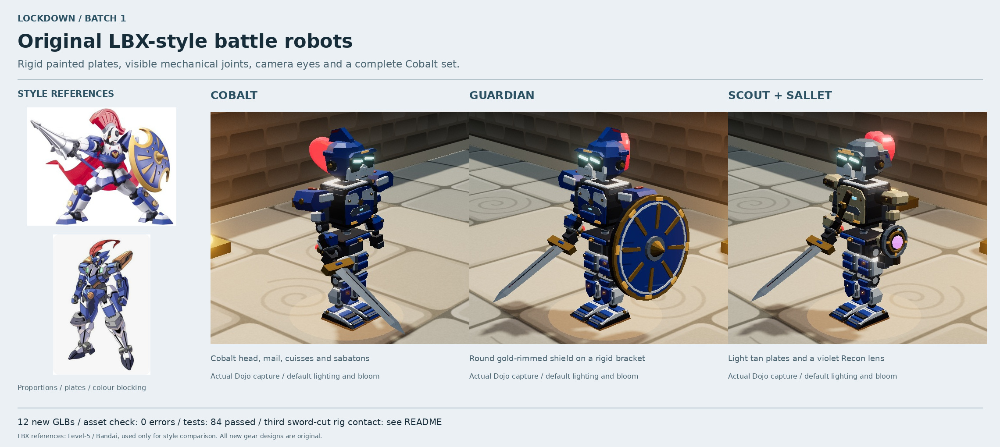

# Batch 1 — original LBX-style robot assets

Twelve original gear and weapon models on `main`'s unchanged 15-part core skeleton (`4e3bcd3`).
The Cobalt build uses blue and white faceted plates, gold fasteners, a small red crest accent,
glowing camera eyes, open mechanical joints and segmented wedge feet. Scout uses lighter tan plates
and a compact sensor buckler; Sallet has a swept metallic head unit.

The batch contains Cobalt and Sallet helmets, Cobalt and Scout armour, Cobalt pants, Cobalt-style
sabatons, Guardian and Recon shields, Knight Brand, Pulse Blaster, and held and planted Cannonball Bombs.
The named parts follow the templates. Each model embeds one painted JPEG, 1024² for armour and 512²
for the rest. Team strips use `team_trim`; optics, the energy cell and the fuse have emissive materials.
The Guardian's rigid bracket places its shield outside the broad pauldron's sweep.

## Review captures

- Default lighting, shadows and bloom: [Cobalt](20-cobalt-hero.jpg),
  [Guardian](21-guardian-hero.jpg), [Scout + Sallet + Recon](22-sallet-scout-hero.jpg).
- Game camera: [idle](01-cobalt-idle-game.jpg), [running](07-cobalt-running-game.jpg).
- Joint motion: [walking](05-cobalt-walking.jpg), [running](06-cobalt-running.jpg),
  [dashing](08-cobalt-dashing.jpg), [side](03-cobalt-side-detail.jpg), [rear](04-cobalt-rear-detail.jpg).
- Three cuts hitting a dummy: [first](09-sword-combo-1.jpg), [second](09-sword-combo-2.jpg),
  [third](09-sword-combo-3.jpg).
- Pulse Blaster: [held](10-blaster-held.jpg), [shooting with barrel recoil](11-blaster-shooting.jpg).
- Class pieces: [Guardian idle](12-guardian-idle.jpg), [guarding](13-guardian-guarding.jpg),
  [Recon](14-sallet-scout-recon.jpg), [cloaking](16-recon-cloaking.jpg).
- Cannonball: [held](17-bomb-held.jpg), [charging](18-bomb-charging.jpg),
  [planted on the floor after stepping away](19-bomb-planted.jpg).

All captures come from `npm start` and the Dojo, with B / the Armory for equipment and normal input
controls for actions. Motion captures are 1280×800 and use the built-in `quality=low` option.
The three lit close-ups are 1600×1000 at default quality. Inspection views move the camera only;
the two game-camera views retain its normal position. Browser time was advanced in small steps to
capture the original engine's actions reliably under software rendering. The review sheet uses crops
of the complete lit captures. References are credited to Level-5 / Bandai and stay in documentation.

## Checks and one animation issue

`node tools/art3d-index.mjs`: **0 errors, 13 models including the core skeleton**.
`npm test`: **84 passed**. Khronos glTF validation: **0 errors and 0 warnings** for every GLB.
The 254 sampled shoulder, elbow, hip, knee and ankle poses clear neighbouring gear surfaces.
The final Dojo session reported **0 browser errors and 0 warnings**.

**Third sword cut:** its cross-body wind-up drives the right forearm through the chest. This occurs
on `main`'s bare core skeleton in the same captured pose and also affects the armour at that moment.
It needs an animation correction; the asset-only prompt requires recording code issues here.
See [the third cut](09-sword-combo-3.jpg) and the core/gear intersection evidence in
[dojo-clearance.json](dojo-clearance.json). The other captured actions clear the checked gear pairs.

[Asset sizes, triangles and validation](asset-audit.json),
[motion states and joint matrices](motion-captures.json), and
[lit capture settings](hero-captures.json) preserve the review evidence.

**Approval checkpoint: batch 2 has not been started.**
