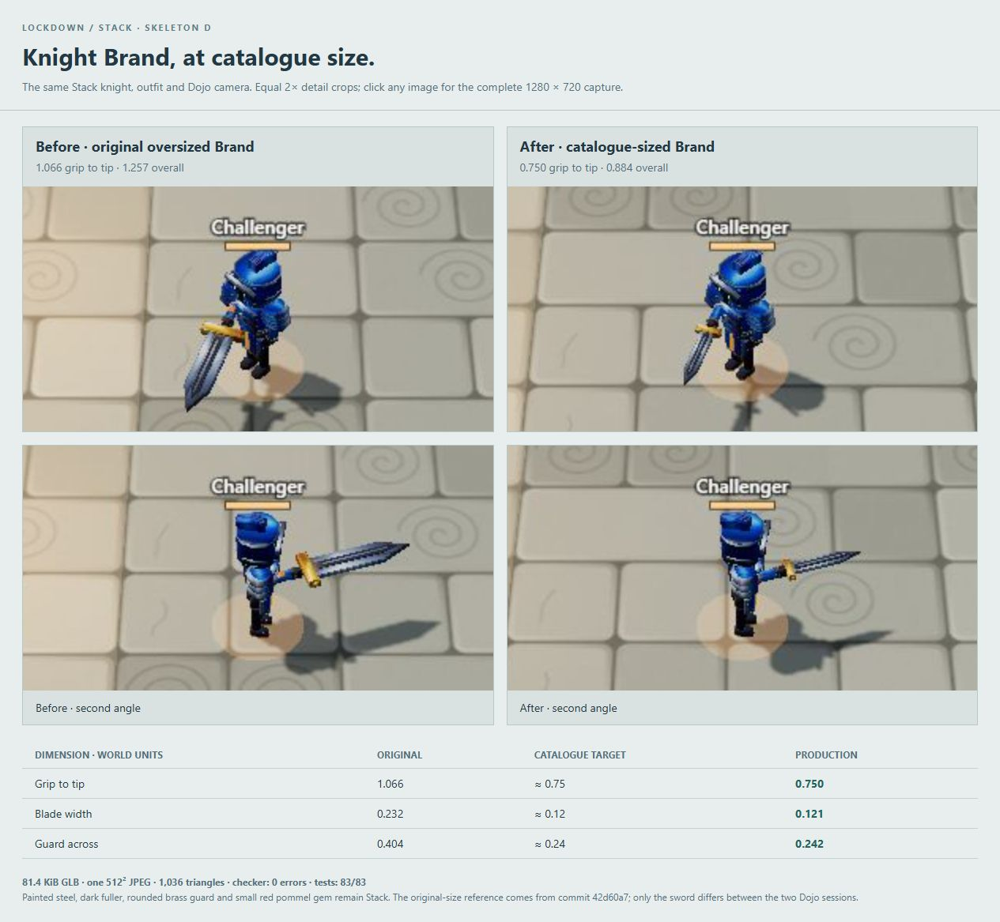

# Knight Brand — catalogue size

Both views use the production Stack/D body, Cobalt helm/mail/cuisses, Striker class and the
unchanged Dojo camera. The sheet uses equal 2× detail crops; these full captures retain game distance:

- Front three-quarter: [original](dojo-old-front.jpg), [catalogue size](dojo-new-front.jpg).
- Second angle: [original](dojo-old-side.jpg), [catalogue size](dojo-new-side.jpg).

| Dimension | Original model | Catalogue target | Production model |
|---|---:|---:|---:|
| Grip to tip | 1.066 | ≈ 0.75 | 0.750 |
| Blade width | 0.232 | ≈ 0.12 | 0.121 |
| Guard across | 0.404 | ≈ 0.24 | 0.242 |
| Overall, including pommel | 1.257 | — | 0.884 |

The original oversized model is from `42d60a7`. Main's later `88ac704` copy applies a 0.6 root-node
scale to that old mesh; the before screenshots deliberately use the original unscaled asset.
The production GLB is authored at catalogue size, with no compensating node scale.

`weapons/brand.glb` is **83,304 bytes (81.4 KiB)**, with **one embedded 512 × 512 JPEG** containing
only the used Stack/shared swatches, and **1,036 triangles**. Painted steel, the dark fuller, rounded
brass guard and the small red pommel gem are retained. The expanded audit checks all three dimensions.

After pulling main and retaining the compact production files: `node tools/art3d-index.mjs`
reports **0 errors / 13 models**, `npm test` passes **83/83**, and Khronos glTF validation reports
zero errors/warnings for the eleven Step 1 assets. Scout/Sallet are incoming main assets.
`docs/MODELS.md` still has older 1.0/1.3 sword examples; ART-GUIDE and the per-item catalogue sizes take precedence.

The corrected view is the actual game on port 3000. To reproduce the old-size comparison, run
`node review/step1-stack/serve-sword-comparison.mjs` alongside `npm start`, then open
<http://localhost:3013/lockdown.html?solo=1&dojo=1>. It proxies the same game and overrides only
the Brand GLB using the historical Git blob. It never writes the old asset into `public/`.
Open <http://localhost:3013/comparison/> for the sheet with full screenshot links.

Further swords will use their individual catalogue sizes: normal ≈ 0.75, heavy ≈ 0.95,
rapier/Tidebreaker ≈ 0.9 and slim, four-cut swords ≈ 0.6. This revision adds no other swords.
