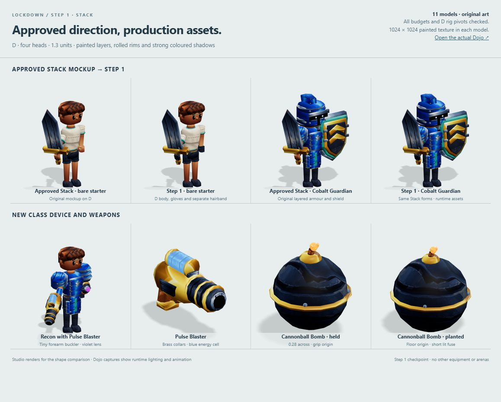
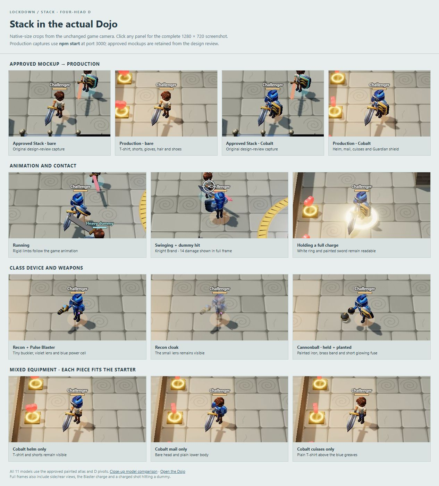

# Stack, four-head D — Step 1 approval

Chosen direction: **Stack** on **D**, `knight_rig_4_heads.glb`.
Production assets keep the layered plates, banded helmets, rolled rims, saturated painted gradients,
dark seams and broad edge highlights of the approved mockups.

The comparison sheet uses **native-size crops**. All `dojo-*.jpg` action captures are complete
1280 × 720 screenshots from `npm start` and `http://localhost:3000/lockdown.html?solo=1&dojo=1`.
Equipment and weapons were changed through B / the Armory; movement and attacks used normal controls.

- [Bare starter](dojo-bare-idle.jpg) and [Cobalt Guardian idle](dojo-cobalt-idle.jpg).
- [Running](dojo-running.jpg), [swinging and hitting a dummy](dojo-swing-hit.jpg), [full sword charge](dojo-charging.jpg).
- [Side](dojo-cobalt-side.jpg) and [rear](dojo-cobalt-rear.jpg) views.
- [Helmet only](dojo-mix-helmet.jpg), [mail only](dojo-mix-mail.jpg), [cuisses only](dojo-mix-cuisses.jpg).
- [Recon with Blaster](dojo-recon-blaster.jpg), [lens during cloak](dojo-recon-cloak.jpg),
  [Blaster charge](dojo-blaster-charge.jpg), [charged shot hitting a dummy](dojo-blaster-fired.jpg).
- [Held Cannonball](dojo-bomb-held.jpg), [bomb charging](dojo-bomb-charge.jpg), [planted Cannonball](dojo-bomb-planted.jpg).

Validation: art index **0 errors / 11 models**; `npm test` **81/81 passing**;
Khronos glTF Validator **0 errors and 0 warnings** for all eleven files.
[Asset audit](asset-audit.json) records triangles, dimensions and validator results.
All models are within their budgets, have an embedded 1024 × 1024 texture and contain no skins or animations.
The body preserves D's named hierarchy and pivots, spans Y = 0 to 1.3 and faces +X.
No browser console errors or warnings were reported during the Dojo checks.

The generic three-head catalogue wording remains unchanged; the explicit D choice is recorded in
[ART-GUIDE.md](../../ART-GUIDE.md#chosen-direction-stack). No gameplay or renderer changes.
This is the approval checkpoint; other equipment, icons and arenas have not been started.
